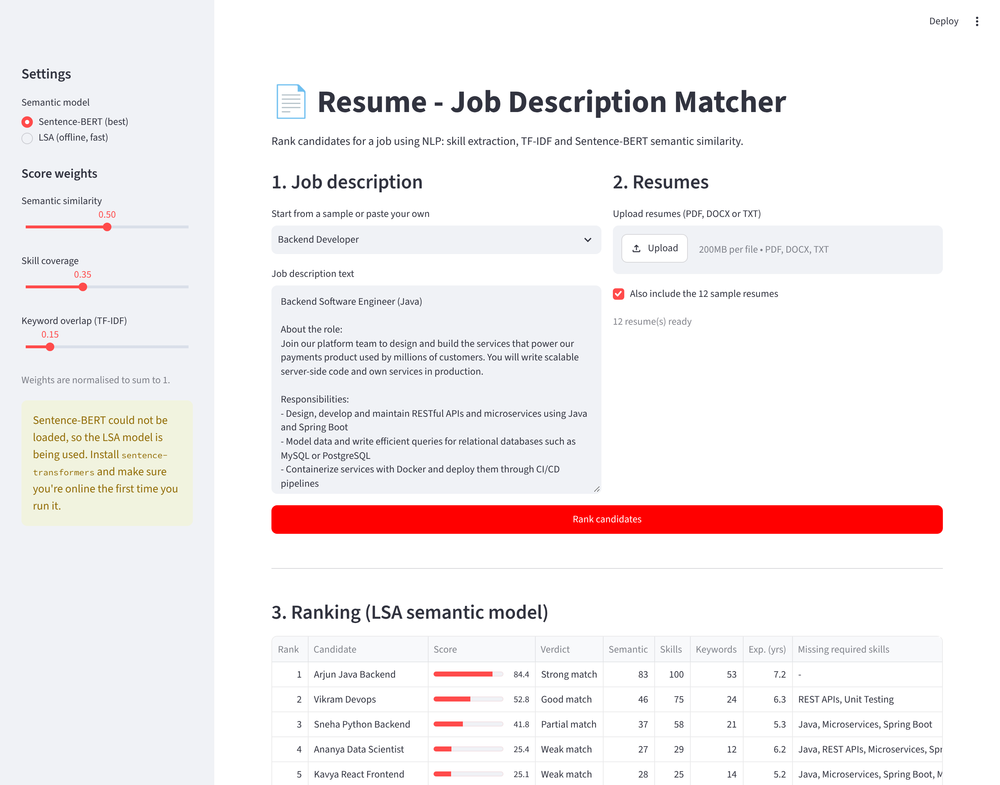

# Resume – Job Description Matcher (NLP Mini Project)

This tool ranks candidate resumes against a job description. It combines three NLP techniques:
rule-based **skill extraction**, **TF-IDF** keyword similarity and **Sentence-BERT** semantic similarity.
For every candidate it explains the score: matched and missing skills, years of experience, and which
resume lines support (or fail to support) each requirement in the job description.



---

## 1. Problem statement

Recruiters receive hundreds of resumes for each opening. Plain keyword filters (ATS systems) miss
candidates who describe the same skill in different words ("built server-side services" vs
"backend API development"). They also reward keyword stuffing. The goal of this project is to
build a matcher that understands meaning, gives a ranked shortlist, and explains each decision.

## 2. Pipeline

```
 Resume (PDF/DOCX/TXT)        Job description
          │                          │
          ▼                          ▼
  Text extraction + cleaning (remove emails, URLs, phone numbers, bullets)
          │                          │
          ├──► Sentence/bullet chunking ◄──┤
          │                          │
  ┌───────┴──────────┬───────────────┴───────────┐
  ▼                  ▼                           ▼
 TF-IDF cosine    Skill extraction            Sentence-BERT
 (unigrams +      (taxonomy of ~90 skills,    (all-MiniLM-L6-v2;
  bigrams)         aliases, implied skills,    each JD requirement is
                   required vs optional,       matched to its most
                   "A or B" alternatives)      similar resume line)
  │                  │                           │
  └────────► Weighted hybrid score (0–100) ◄─────┘
                       │
                       ▼
     Ranking + explanation (matched/missing skills, evidence, gaps, experience)
```

### Components

| Module | What it does | NLP concepts |
|---|---|---|
| `matcher/text_utils.py` | Reads PDF/DOCX/TXT, cleans text, splits it into chunks, extracts years of experience from date ranges | Preprocessing, tokenisation, sentence segmentation, regex-based information extraction |
| `matcher/skills.py` | Finds skills using a taxonomy with aliases (`k8s` → Kubernetes), adds implied skills (Django → Python), detects "nice to have" sections and "A or B" alternatives | Dictionary-based named entity recognition, normalisation, rule-based parsing |
| `matcher/scoring.py` | TF-IDF, LSA, Sentence-BERT and hybrid scoring, plus explanations | Vector space model, latent semantic analysis, transformer sentence embeddings, cosine similarity |
| `app.py` | Streamlit web demo | — |
| `evaluate.py` | Compares all methods against hand-labelled relevance grades | Information retrieval evaluation (NDCG, MRR, Spearman) |

### Scoring

```
final = 0.50 × semantic + 0.35 × skill_coverage + 0.15 × tfidf      (each signal rescaled to 0–1)
```

* **Skill coverage** is the weighted share of JD requirements found in the resume.
  Required skills weigh 1.0, nice-to-have skills 0.5 and soft skills 0.25. A requirement such as
  "MySQL or PostgreSQL" is satisfied by either skill.
* **Semantic score**: for every JD chunk *j*, take the maximum cosine similarity to any resume
  chunk, then average over all *j*. Comparing chunk by chunk works better than one embedding per
  document, because MiniLM truncates long inputs (256 tokens) and a single document vector blurs
  separate requirements together.
* The weights can be changed with sliders in the app.

If `sentence-transformers` is not installed or the model can't be downloaded, the code falls
back to **LSA** (TF-IDF + truncated SVD), so the project still runs offline.

## 3. How to run

```bash
python -m venv venv
source venv/bin/activate          # Windows: venv\Scripts\activate
pip install -r requirements.txt

streamlit run app.py              # web demo  -> http://localhost:8501
python evaluate.py                # evaluation table (SBERT if available, else LSA)
python evaluate.py --backend lsa  # force the offline model
python -m pytest -q               # unit tests
```

The first run downloads the `all-MiniLM-L6-v2` model (~90 MB) from Hugging Face, so you need
internet access for that run. After that it works offline.

## 4. Dataset

`data/` contains a small hand-made benchmark:

* **4 job descriptions**: Data Scientist, Backend Developer (Java), Frontend Developer (React),
  Cybersecurity Analyst
* **12 resumes**: strong fits, partial fits (e.g. data analyst → data scientist, network engineer → SOC
  analyst, DevOps → backend) and one off-domain resume (mechanical engineer)
* **`labels.csv`**: 48 (job, resume) pairs graded 0–3 (3 = ideal, 2 = good, 1 = partial, 0 = not relevant)

All names and companies in the sample resumes are fictional.

## 5. Results

Averaged over the 4 jobs. These numbers come from the offline **LSA** backend. Run `python evaluate.py`
with sentence-transformers installed to add the Sentence-BERT row for your report.

| Method | NDCG@5 | MRR | Top-1 Acc | Spearman ρ |
|---|---|---|---|---|
| TF-IDF | 0.982 | 1.00 | 1.00 | 0.776 |
| Skill match | 0.989 | 1.00 | 1.00 | 0.796 |
| Semantic (LSA) | 0.979 | 1.00 | 1.00 | 0.743 |
| Hybrid (LSA) | 0.979 | 1.00 | 1.00 | 0.759 |
| Semantic (SBERT) | *run locally* | | | |
| Hybrid (SBERT) | *run locally* | | | |

**Observations**
* Every method puts the ideal candidate first (MRR = 1). The jobs come from clearly different
  domains, so finding the best candidate is easy. The real differences show up in how the
  *partial* candidates are ordered, which Spearman ρ measures.
* Skill matching has the highest Spearman correlation on this data. The resumes are written
  with explicit skill keywords, which favours lexical methods.
* **Error analysis**: for the Backend job, the DevOps resume (label 1) is ranked above the Python
  backend resume (label 2). The DevOps resume mentions Java/Spring Boot, Docker, Kubernetes and
  CI/CD, which overlap with many JD skills. The Python developer writes backend code daily but in
  a different stack. Deciding which candidate is "more relevant" is subjective, which is a known
  difficulty in building labels for this task.
* Run the evaluation with SBERT and compare its rows with LSA. Paraphrased requirements are where
  you'd expect SBERT to do better.

Per-job metrics and full rankings are saved in `results/`.

## 6. Limitations and future work

* The skill taxonomy is hand-built (~90 skills). It could be replaced with ESCO/O*NET, or with
  a fine-tuned NER model (e.g. spaCy or BERT token classification) trained on labelled resumes.
* The benchmark is small (48 pairs). Larger public datasets, such as the Kaggle "Resume Dataset"
  (2,400 resumes across 24 categories), would give more reliable numbers.
* The calibration ranges in `scoring.py` (`CALIBRATION`) and the hybrid weights were set by hand.
  They could be learned with logistic regression on labelled pairs.
* A cross-encoder re-ranker (e.g. `cross-encoder/ms-marco-MiniLM-L-6-v2`) could re-score the top-k
  candidates more accurately.
* Fairness: the system ignores names, but bias can still enter through university names, gaps in
  employment or wording. Any real use would need a bias audit.

## 7. Project structure

```
resume_matcher/
├── app.py                 # Streamlit demo
├── evaluate.py            # evaluation script
├── requirements.txt
├── matcher/
│   ├── text_utils.py      # loading, cleaning, chunking, experience extraction
│   ├── skills.py          # skill taxonomy + extraction
│   └── scoring.py         # TF-IDF, LSA, SBERT, hybrid + explanations
├── data/
│   ├── jobs/              # 4 sample JDs
│   ├── resumes/           # 12 sample resumes
│   └── labels.csv         # relevance grades
├── results/               # evaluation output (CSV)
├── tests/test_matcher.py  # unit tests
└── docs/results.png
```
